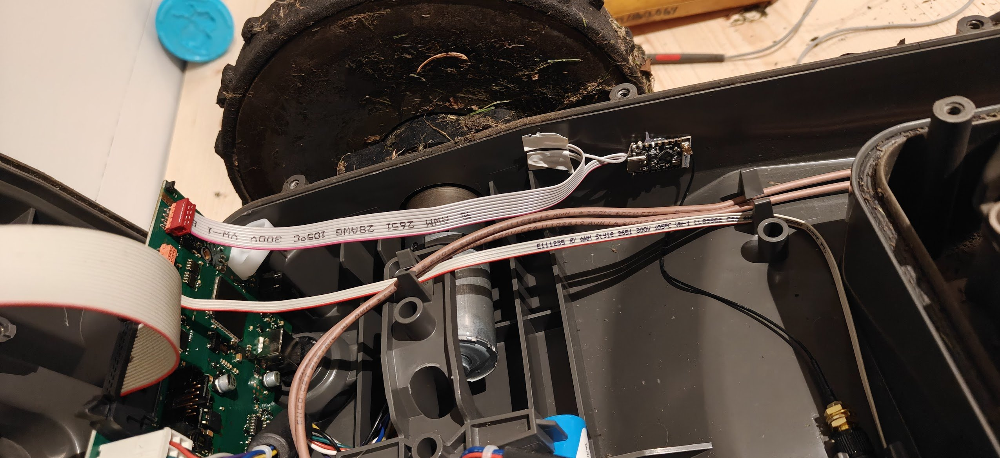
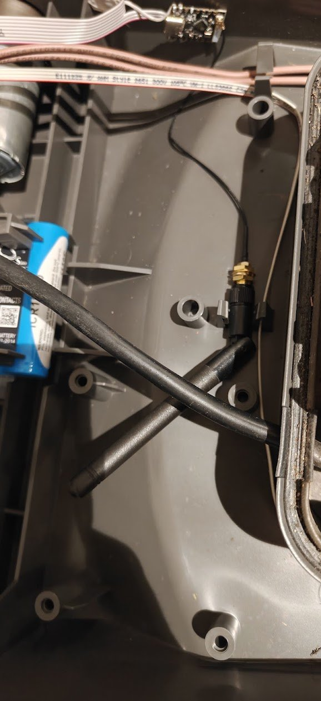
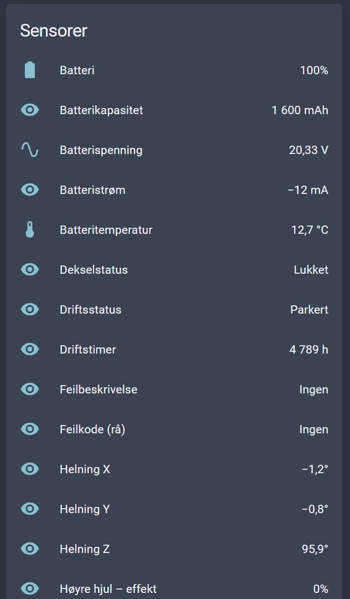
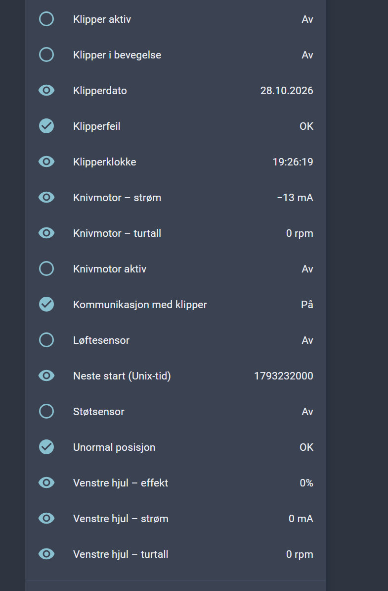

# Automower 310 with ESPHome and ESP32-C3

**All project code was generated with ChatGPT.** Hardware observations and installation photos were provided by the owner. AI-generated code can contain errors; review and test it before use.

An unofficial Home Assistant integration for the Husqvarna Automower 310, using its AUX1 UART interface and an ESP32-C3 Super Mini. Based on the original v3.8 smart-polling configuration. This is a hobby project, not a Husqvarna product.

The repository name refers to Generation 3. Compatibility with every Gen3 model is **not** confirmed.

## Latest update: v3.10-test1

This update adds timer endpoint editing, persistent **Skip mowing today**, and combined date/clock synchronization, all running on the ESP32. It also includes the v3.9 timer readings, readable next-start time and improved command acknowledgements. No rain automation is included; this can be added in Home Assistant later.

**Test status: tested by the owner on a Husqvarna Automower 310.** The owner confirmed testing of this version on 2026-10-29. The original Norwegian version also worked very well. Full compilation and input-validation tests passed. Other Gen3 models may work but have not been tested.

See [CHANGELOG.md](CHANGELOG.md), [TESTING.md](TESTING.md) for operation and testing, and [VALIDATION.md](VALIDATION.md) for exact checks.

### Updating an existing installation

Back up your working YAML and keep your existing device name, Wi-Fi, API encryption, OTA password and any static-IP settings. Replace the complete device YAML rather than merging fragments, then restore those local settings. Existing Secrets names may differ from the generic names in this repository. Keep the actual credentials unchanged. The original private v3.8 file had no OTA password; the shareable edition requires `ota_password` in Secrets. Never copy private values into GitHub.

## Set up everything in the ESPHome app

You enter your Wi-Fi details, mower PIN and passwords locally in **ESPHome Device Builder** (the ESPHome app in Home Assistant). You do not need to put any credentials on GitHub.

1. Open **Settings → Apps** in Home Assistant and install/start **ESPHome Device Builder** if needed. Older Home Assistant versions call Apps “Add-ons”. Open its web interface. If you run Home Assistant without the app store, use a separate ESPHome Device Builder installation.
2. Download `automower-310.yaml` and `secrets.example.yaml` from this repository. Alternatively, clone it:

   ```sh
   git clone https://github.com/captnalex/esphome_automower_3g.git
   cd esphome_automower_3g
   ```

3. Select **Create device → Import from File** and import `automower-310.yaml`. If your app version does not offer file import, create an ESP32-C3 device, open **Edit**, and replace its configuration with the complete contents of `automower-310.yaml`. Keep the YAML filename you chose in the app; the command-line examples below assume `automower-310.yaml`.
4. Open **Secrets** in the ESPHome dashboard. Add the keys from `secrets.example.yaml` and replace every placeholder with your own value. If you already have secrets, merge the entries rather than replacing the whole file. Secrets are stored in the local `secrets.yaml` file.

   | Secret | What to enter |
   | --- | --- |
   | `automower_pin` | Your mower's existing four-digit PIN, in quotes. Leading zeros are supported. |
   | `wifi_ssid` | Your Wi-Fi network name. |
   | `wifi_password` | Your Wi-Fi password. |
   | `api_encryption_key` | Your own 32-byte, Base64-encoded ESPHome API encryption key. |
   | `ota_password` | A long, unique password for wireless firmware updates. |

   You can keep the API encryption key generated by the ESPHome new-device wizard and put it in Secrets. Alternatively, generate one locally:

   ```sh
   python -c "import base64,secrets; print(base64.b64encode(secrets.token_bytes(32)).decode())"
   ```

5. Save both the device configuration and Secrets. The default is DHCP, device name `automower-310`, and time zone `Europe/Oslo`. Change the name for additional devices and the time zone for your location.
6. Use **Validate** in the device menu, then **Install**. Install the first firmware over USB using the method offered by your ESPHome installation. Check the board, wiring and power supply first. Later wireless updates use your OTA password.
7. Add the device through Home Assistant's **ESPHome integration**, supplying your API key when prompted. If migrating from old firmware with a different key, update/reconfigure the integration accordingly.
8. Under physical supervision, first check sensor readings, PIN status and STOP. Test START and mode changes only when the working area is clear and mower movement is safe.

Missing secrets stop configuration validation. A PIN that is not exactly four decimal digits is rejected by the firmware without sending authentication. Do not put C++ expressions or embedded quote characters in the PIN value. To change the PIN used by this integration, edit Secrets and reinstall the firmware; this does not change the mower's own PIN.

### Optional command-line setup

Keep `automower-310.yaml` and your private `secrets.yaml` in the same folder. The ESPHome version used for validation is pinned in `requirements-dev.txt`.

```sh
python -m pip install -r requirements-dev.txt
esphome config automower-310.yaml
esphome compile automower-310.yaml
python check_frames.py
python check_config.py
```

## Shopping list

Parts used in the owner's installation:

| Quantity | Part | Link / notes |
| --- | --- | --- |
| 1 | 8-pin Micro-MaTch connector / cable | [Owner's Micro-MaTch 8P listing](https://www.aliexpress.com/item/1005013047292562.html). Select the 8-pin version and check connector orientation. |
| 1 | ESP32-C3 board | [Owner's ESP32 listing](https://www.aliexpress.com/item/1005012967946988.html). The YAML targets ESP32-C3 with GPIO4 RX / GPIO5 TX; select the matching variant, including an external antenna connector if using the illustrated antenna. |
| 1 set | Compatible 2.4 GHz Wi-Fi antenna and antenna cable | Required for the illustrated external-antenna installation; check whether included with the board and match its RF connector. |
| As needed | Hook-up wire / ribbon cable, insulation and mounting adhesive | Connect RX, TX, GND and 5 V, secure the board, and provide cable strain relief. |
| 1 | USB data cable | For initial firmware installation. |

These are owner-supplied shopping links, not independently verified product specifications. Listings can offer several variants; check the selected options before ordering. Prices and availability are not tracked.

## Installation photos

The owner glued the ESP32 to the **inside side wall of the mower**. The antenna is secured at the **bottom of the mower in an existing clip**. Route wiring clear of moving parts and the enclosure seal, insulate exposed connections, and provide strain relief. The photos illustrate this installation rather than a universal mounting requirement.



*ESP32 mounting on the side wall and AUX1 cable routing.*



*Antenna held in an existing clip at the bottom of the mower.*

## Wiring

The following AUX1 connections were reported physically tested on the original Automower 310. **Check connector orientation, board revision and signal voltage on your own mower.** This is not a universal pinout guarantee.

| Automower AUX1 pin | ESP32-C3 connection |
| --- | --- |
| 1 | GPIO4 / RX |
| 2 | GPIO5 / TX |
| 3 | GND |
| 6 | **5 V supply** to the board's suitable 5 V input, subject to its power requirements |

The owner confirmed **AUX1 pin 6 is 5 V**. The owner reports that this 5 V supply switches off when the mower enters sleep. Its current capacity has not been quantified. Ensure the supply is stable and suitable for your board. ESP32-C3 GPIO pins must not receive 5 V. **Never connect AUX1 pin 7 (approximately 18 V) directly to the ESP32 board.** Disconnect power before wiring or servicing.

UART: 115200 baud, 8 data bits, no parity, 1 stop bit.

## Sleep limitation: no remote wake-up

**When the mower goes to sleep, the 5 V supply on AUX1 pin 6 is lost. The ESP32 therefore powers off and cannot receive Wi-Fi, Home Assistant or UART commands. This setup cannot wake the mower from sleep.** This behavior was observed by the owner on this installation. Changing a polling interval or pressing START in Home Assistant cannot restore power to the ESP32.

## Features and behavior

- Operating status and mode, battery, wheel and blade motor readings, collision/lift/tilt readings and diagnostics.
- Distributed polling: wheel speed approximately every 0.2 seconds; wheel power/current published every 1 second; status/blade every 2 seconds; other data less often.
- AUTO/MAN/HOME selection, separate START/STOP, PIN authentication and manual date/clock synchronization.
- No GPS, wake relay or automatic START on boot. **A mode change may still cause movement**, depending on mower firmware.
- Date/clock synchronization preserves the mower display format and checks both writes by readback. It requires accepted PIN, valid Home Assistant time and fresh Parked/Charging status.
- Timer editing is disabled after each boot until **Allow experimental timer changes** is enabled. Select an endpoint, Load, edit its time/days, then Apply. Each write changes one endpoint and is read back; it is not an atomic whole-week update.
- **Skip mowing today** requests HOME without changing timer settings. The saved hold survives restarts. On the next local day, AUTO is restored only if the mower was previously in AUTO; this can cause movement. An unpowered ESP32 must first wake by other means. **Cancel skip today** can restore AUTO early; **Stop mower** disables automatic skip commands/resumption.
- Control results distinguish sent commands, acknowledgements, observed states, rejection and timeout. An acknowledgement alone does not prove the mower moved or physically stopped.
- After 60 seconds without a valid UART response, communication is marked lost. Existing readings may remain visible but are historical. When the mower enters sleep, AUX1 loses its 5 V supply and the ESP32 turns off, making the device unavailable in Home Assistant. **You cannot wake the mower from sleep through this integration**, because the ESP32 has no power. The mower must wake by its own supported means before the integration reconnects.
- Automatic authentication requires a fresh response and is attempted once per session. If the PIN is rejected, check the configuration rather than repeatedly pressing Authenticate PIN. The mower's own lockout rules still apply.

## Parameter and entity list

The following list is taken from `automower-310.yaml`, including the controls, measurements and diagnostic entities it actually exposes. These are not all commands supported by the mower protocol. Wi-Fi, PIN and password settings are listed under **Set up everything in the ESPHome app** above.

### Controls

| Entity | Unit / meaning |
| --- | --- |
| Synchronize date and clock | Preserve display format; write/read back date and time while parked/charging |
| Load timer for editing | Load the selected endpoint into draft inputs |
| Apply timer endpoint | Explicitly write and read back one endpoint; requires editing enabled and parked/charging |
| Skip mowing today | Request HOME until the next local day; persist the hold |
| Cancel skip today | End the hold; may restore AUTO and cause movement |
| Authenticate PIN | Send the configured PIN; never shows the PIN value |
| Stop mower | Send STOP; not a physical emergency stop |
| Start mower | Send START; requires PIN, fresh contact and no skip hold or competing settings/control transaction |
| Refresh status | Request a new operating-status response |

### Mode selector

| Entity | Unit / meaning |
| --- | --- |
| Select operating mode | AUTO / MAN / HOME; changing mode may cause movement |

### Timer editing inputs

| Entity | Meaning |
| --- | --- |
| Timer endpoint to edit | Timer 1/2 start/end selector |
| Timer draft time | HH:MM; 24:00 is the documented disabled endpoint |
| Timer draft weekdays | Comma-separated Mon,Tue,Wed,Thu,Fri,Sat,Sun; no spaces; empty means no days |
| Allow experimental timer changes | Opt-in switch; off after every reboot |

Draft edits do not send commands. Load an endpoint before applying. See [TESTING.md](TESTING.md) for the full workflow and partial-write limitations.

### Numeric sensors

| Entity | Unit / meaning |
| --- | --- |
| Battery | % |
| Battery voltage | V |
| Battery current | mA |
| Battery capacity | mAh |
| Battery temperature | °C |
| Operating hours | h |
| Left wheel - power | % |
| Left wheel - speed | mm/s |
| Left wheel - current | mA |
| Right wheel - power | % |
| Right wheel - speed | mm/s |
| Right wheel - current | mA |
| Blade motor - speed | rpm |
| Blade motor - current | mA |
| Tilt X | ° |
| Tilt Y | ° |
| Tilt Z | ° |
| WiFi signal | dBm |
| ESP32 uptime | s |
| UART CRC errors | count |
| UART rejected responses | count |
| Seconds since last valid response | s |
| Seconds since last status | s |

### Binary sensors

| Entity | Unit / meaning |
| --- | --- |
| Mower communication | On / off |
| Mower active | On / off |
| Mower error | On / off |
| Mower moving | On / off |
| Blade motor active | On / off |
| Collision sensor | On / off |
| Lift sensor | On / off |
| Abnormal position | On / off |

### Text/status sensors

| Entity | Unit / meaning |
| --- | --- |
| Operating status | Parked / Mowing / Returning / Charging / Searching / Error / Unknown / No connection |
| Operating mode | Internal only; reflected by Select operating mode |
| Error code (raw) | Raw error bytes, or None |
| Error description | Decoded error description, or None |
| PIN authentication | Authentication status only, never the secret PIN |
| Last control command | Most recent command result or request |
| Cover status | Open / Closed / Unknown |
| Mower clock | HH:MM:SS |
| Mower date | DD.MM.YYYY |
| Next start (Unix time) | Unix timestamp as text, or Not scheduled |
| Next start (local time) | Local date/time with UTC offset; compare with mower display |
| Timer 1 start / Timer 1 end | Endpoint time, weekday list and enabled flag |
| Timer 2 start / Timer 2 end | Endpoint time, weekday list and enabled flag |
| Schedule edit result | Loaded draft, blocked input, write/readback result |
| Skip today status | Requested/observed hold, cancellation and resumption status |

### Polling and publication intervals

| Data group | Normal interval |
| --- | --- |
| Wheel speed (both wheels) | About 0.2 s |
| Wheel power and current (both wheels) | Published at most every 1 s; latest values from the shared 0.2 s UART response |
| Operating status/mode and blade motor readings | About 2 s |
| Collision, lift and tilt | About 5 s |
| Battery percentage, voltage/current and cover | About 10 s |
| Battery capacity/temperature | Read about every 10 s; published at most every 30 s |
| Operating hours, mower clock, next start and timer endpoints | About 60 s |
| Mower date | About 1 hour |
| Wi-Fi signal / ESP32 uptime | 30 s / 60 s |
| UART diagnostic counters and response/status age | 10 s |
| Missing UART contact while ESP32 is still powered | Status request about every 5 s |

Status-derived binary sensors update with the corresponding response. Text states are event-driven. Normal polling is paused during date/clock and timer-write transactions. Status polling continues while awaiting control acknowledgement/readback. Intervals are approximate; valid responses are required. **An unpowered ESP32 does not poll at all.**

### Serial command reference (RS232/UART)

The serial parameter/command reference was found online, not invented by ChatGPT. The original configuration cites **Robomower V0.8**, by David Gross with Chris P. (ein-stein) and Andi291. See the [original PDF](https://www.mikrocontroller.net/attachment/278555/Robomower_V0.8.pdf) and [author's forum post](https://www.mikrocontroller.net/topic/304526#4403150).

This table describes the subset used by this YAML. Page numbers refer to the PDF; START/STOP details also appear in [Andi291's follow-up](https://www.mikrocontroller.net/topic/304526#4403399).

| Operation | Request opcode / payload | Reference |
| --- | --- | --- |
| Authenticate | `0C / 00 01 PIN-low PIN-high` | p. 6 |
| Read clock / write clock | `02 / 00`; `02 / 80 HH MM SS` | p. 7 |
| Read/write date | `02 / 01`; `02 / 81 year-low year-high month day format` | pp. 8-9 |
| Read timer endpoint | `06 / 01 endpoint` (01/81: Timer 1 start/end; 02/82: Timer 2 start/end) | pp. 22-25 |
| Write timer endpoint | `06 / 02 endpoint hour 00 minute days A0 05` | pp. 26-31 |
| HOME / MAN / AUTO | `0E / 02`, `03`, `04` | p. 32 |
| STOP / START | `0E / 00`, `01` | Forum follow-up |
| Next start | `06 / 05` | p. 34 |
| Operating status | `12 / 01` | p. 35 |
| Battery / wheels / blade | `14 / 01`, `02`, `03` | pp. 37–39 |
| Collision/lift/tilt / cover | `14 / 04`, `05` | pp. 40–41 |

Frames use `02`, opcode, payload length, payload, Dallas CRC8 and `03`; serial settings are 115200, 8N1. This is community reverse-engineering, not an official Husqvarna specification. The **AUX1 UART signal levels must be checked separately**: “RS232” is used here as a serial-reference search term, not permission to connect conventional positive/negative-voltage RS-232 directly to ESP32 GPIO. Use the owner-confirmed wiring above for this installation; the older PDF uses RX/TX labels from a different perspective.

## Home Assistant examples

These screenshots are from the owner's earlier **Norwegian-language configuration**. The configuration in this repository uses English entity names. The readings are examples, not reference values for your mower.





## Safety and secrets

Use only on a mower you own or are authorized to control. Hardware modifications can damage electronics and affect sealing and warranty. This software is not a safety system. Keep all original safety features operational. A network/UART STOP is not a substitute for the physical stop button or safe power isolation during maintenance. Keep people and animals clear during testing.

`secrets.yaml` separates credentials from shared configuration; it does not encrypt them on disk. Secrets are embedded in compiled firmware. **Never publish secrets, firmware binaries, generated C++, build folders, configuration dumps, backups or raw UART captures.** The authentication telegram contains PIN data. `.gitignore` excludes common sensitive files, but does not remove already tracked files or Git history. Review every publication and rotate credentials that have been exposed.

Use API encryption and unique passwords on a trusted local network. Do not expose API/OTA ports directly to the internet. Protocol interpretation and compatibility with other mower models/firmware are not guaranteed. Compilation is not a substitute for physical testing.

All entity labels, status messages and comments are in English. When migrating from the Norwegian configuration, entity IDs in Home Assistant may change or old entities may remain; update dashboards and automations as needed. Internal identifiers were also translated consistently.

## Original changes from v3.8

- Personal PIN and API key replaced by `!secret` references; no original credentials are distributed.
- Four-digit decimal PIN parsing, including leading zeros; invalid format sends no authentication.
- OTA password stored in Secrets; DHCP replaces private fixed network addresses.
- Automatic authentication now requires a UART response less than 30 seconds old.
- English configuration, documentation, example secrets and ignore rules.

## Credits and validation

The original configuration credits Robomower V0.8, Wall-E v1.20 and diagnostic ideas from AMConnect. The Robomower protocol source is linked above. License records for the combined material have not been established. No new license is assigned here; verify applicable permissions before relicensing it. The ChatGPT-generated implementation uses community protocol research; authorship of that research belongs to its contributors.

See [VALIDATION.md](VALIDATION.md) for checks and limitations.

- [ESPHome YAML and secrets](https://esphome.io/guides/yaml/)
- [Installing ESPHome Device Builder](https://esphome.io/install/)
- [ESPHome Device Builder walkthrough](https://esphome.io/install/getting-started/)
- [ESPHome substitutions](https://esphome.io/components/substitutions/)
- [ESPHome API encryption](https://esphome.io/components/api/)
